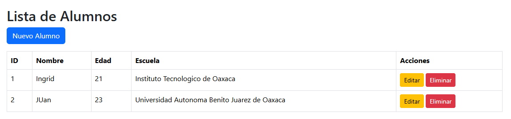
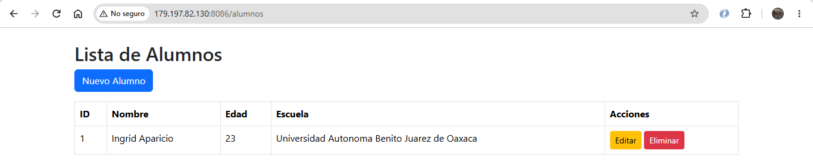
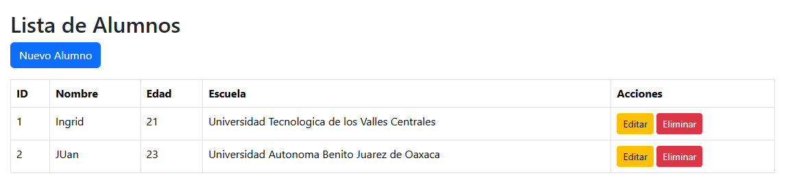
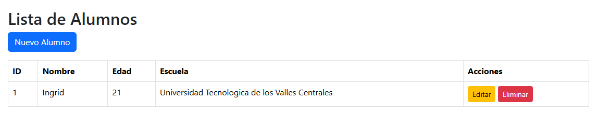
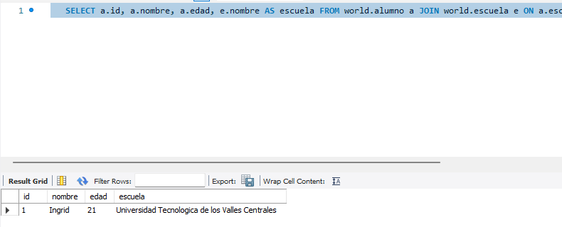

# AAIact3_t4

**Autora:** Ingrid Arcadio Aparicio

**Actividad:** Act3. CRUD en Spring Boot con JPA y MySQL

## Descripción

CRUD de alumnos conectado a MySQL. Cada alumno pertenece a una escuela, usando una relación `@ManyToOne`.

## Entidades

| Entidad | Campos | Relación |
|---|---|---|
| `Escuela` | id, nombre | Una escuela tiene muchos alumnos |
| `Alumno` | id, nombre, edad, escuela | Muchos alumnos pertenecen a una escuela (`@ManyToOne`, llave foránea `escuela_id`) |

## Estructura

| Capa | Archivos |
|---|---|
| Modelo | `Alumno.java`, `Escuela.java` |
| Repository | `AlumnoRepository.java`, `EscuelaRepository.java` |
| Service | `AlumnoService.java` |
| Controller | `AlumnoController.java` |
| Vistas | `alumnos.html`, `alumno_form.html` |

## Endpoints

| Operación | Método | Ruta |
|---|---|---|
| Leer | GET | `/alumnos` |
| Crear (formulario) | GET | `/alumnos/nuevo` |
| Crear y actualizar | POST | `/alumnos/guardar` |
| Actualizar (formulario) | GET | `/alumnos/editar/{id}` |
| Eliminar | GET | `/alumnos/eliminar/{id}` |

**Proyecto en el VPS:** http://179.197.82.130:8086/alumnos

## Ejemplo del video

CRUD de ciudades (`City`) hecho siguiendo el video de referencia.

| Controlador | Ruta | Enlace |
|---|---|---|
| `CityController` | `/` | http://179.197.82.130:8086/ |

## Capturas

### Crear

### Leer, con el nombre de la escuela

### Actualizar

### Eliminar

### Relación en MySQL

## Despliegue

Corre en el puerto **8086** del VPS, en la carpeta `~/act3`. Las credenciales de la base de datos del VPS se pasan al ejecutar el `.jar`, no están en el repositorio. Las Actividades 1 y 2 siguen en los puertos **8082** y **8083**.